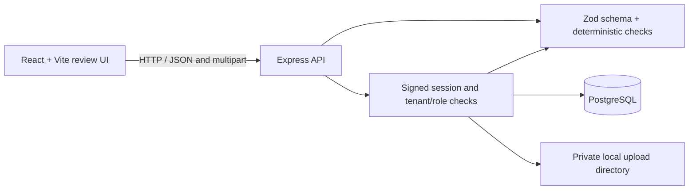
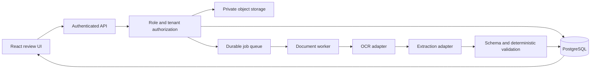

# Architecture and implementation status

## Current prototype

The browser uses the Vite `/api` proxy in development. Invoice rows, fractional line items, document metadata, review history, and audit events are persisted through Drizzle transactions. Authenticated routes resolve tenant scope from a signed HttpOnly session; file downloads authorize the document against that tenant before reading local storage. There are no illustrative invoice records in the live queue.

Local disk is not object storage. The current session design does not include invitations/email verification, MFA, revocation, or rate limits. The prototype is not ready for public financial-data deployment.

## Target release architecture

The target is a modular monolith plus a separately scalable worker, not a collection of microservices. Provider adapters must keep OCR/LLM vendor details outside the invoice domain. Document text is untrusted input; it must never control authorization, tenant IDs, or approval state.

## Data flow and invariants

1. Authenticate and authorize the upload before accepting a document.
2. Validate file size and file signature; calculate a content hash and enforce idempotency.
3. Store the original in private object storage and create metadata/job rows transactionally or with an explicit recoverable outbox.
4. Process asynchronously. Store OCR text and structured extraction only under the owning tenant's scope.
5. Validate outputs against a versioned shared contract and deterministic rules. Unknown values remain null/unknown.
6. Present uncertain or inconsistent values for human review. Validation never implies approval.
7. Record corrections and approvals as append-only audit events. Reprocessing creates a new extraction version.

## Current data model

`apps/api/src/db/schema.ts` defines organizations (`tenants`), users, invoices, invoice items, audit logs, review history, and uploaded document metadata. Committed Drizzle migrations are in `apps/api/drizzle`. Invoice creation/update and status changes persist their related line items and history in transactions. History is append-only through the current API surface; no database immutability trigger or restricted database role is configured.

## Operational dependencies for a real deployment

- PostgreSQL with backups and tested migrations.
- Private object storage, encryption, access controls, lifecycle policy, and malware scanning.
- Durable queue and worker; bounded exponential retry with jitter and dead-letter handling.
- Authentication provider or securely implemented session/JWT lifecycle with key rotation.
- OCR/extraction runtime selected after measuring representative English and Arabic fixtures.
- Monitoring that redacts document contents, credentials, and personal data.
